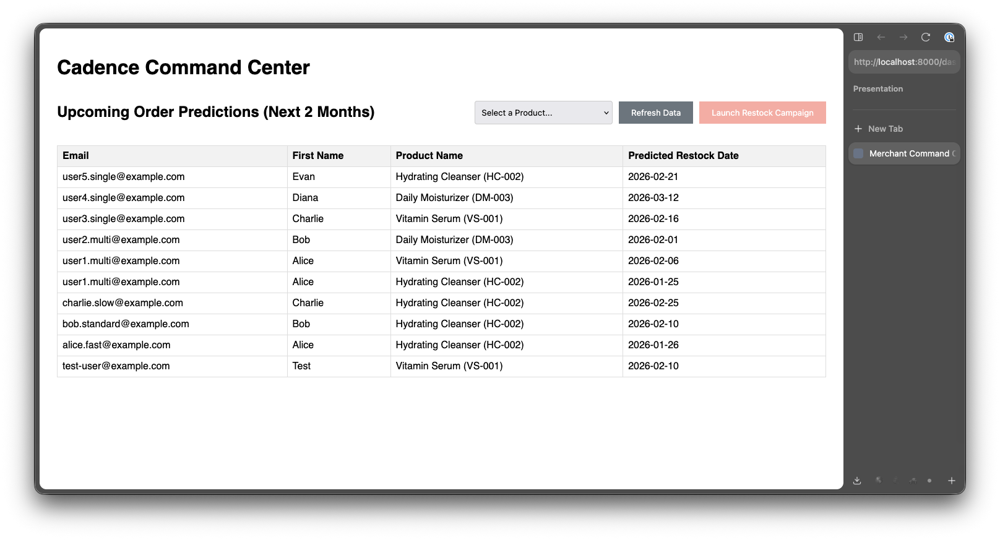

# Klaviyo Cadence

### Winter Challenge

## Project Title

**Klaviyo Cadence**

## Problem Statement

Timing is everything in marketing. For consumable products (skincare, supplements, pet food), or even clothing, generic "30-day" or "2 year" reminder flows can often inaccurate. Some customers use products faster (high "burn rate"), while others are slower. Sending reminders too early annoys customers; sending them too late can lead to them trying a new product.

**Klaviyo Cadence** solves this by calculating a personalized **Burn Rate** for each customer based on their recent purchase history. It uses this information to empower marketers to target them in a more dynamic and data-driven way.

## Solution Overview

Klaviyo Cadence is a Node.js application that integrates deeply with the Klaviyo platform to intelligentize replenishment workflows.

**Key Features:**

- **Informed Prediction:** Calculates a unique consumption rate for each user by analyzing the time intervals between their past orders of specific products.
- **Catalog Integration:** Uses Klaviyo Catalog custom metadata to define baseline "expected lifetimes" for products (e.g., a bottle of cleanser lasts ~45 days).
- **Profile Enrichment:** Writes the predicted "Reorder Date" back to the customer's Klaviyo Profile as a custom property, making it available for segmentation.
- **Marketer Dashboard:** A visual interface to view upcoming demand (who will likely be buying soon).
- **Orchestration:** Allows marketers to launch targeted, one-off campaigns to a specific cohort of "ready-to-buy" users directly from the dashboard.

## Architecture / Design Decisions

The project is built as a modular **Node.js** application using **TypeScript** and **Express**.

- Service-Oriented Architecture: Business logic is encapsulated in distinct services (`ReplenishmentService`, `OrchestrationService`, `DashboardService`) to keep the codebase clean and testable.
- Frontend: Uses Embedded JavaScript (EJS) for server-side rendering of the dashboard. This was chosen for simplicity and speed of development, avoiding the additional complexity with single page applications.
- Data Flow:
    1.  Ingest: An order webhook triggers the `ReplenishmentService`.
    2.  Process: The app fetches the user's history and the product's catalog metadata to calculate the next due date.
    3.  Store: The predicted date is written to the Klaviyo Profile.
    4.  Visualize: The `DashboardService` queries these profiles to show a demand forecast in the next 2 month window.
    5.  Act: The `OrchestrationService` creates a dynamic Segment and sends a Campaign via the Klaviyo API.

## Klaviyo API / SDK / MCP Usage

This project utilizes the `klaviyo-api` Node.js SDK to interact with several core Klaviyo APIs:

- **Catalogs API:** Fetches product details and custom metadata (e.g., `expectedLifetimeDays`) to establish a baseline for consumption.
- **Events API:** Queries `Placed Order` events to analyze customer purchase frequency and calculate their personal "burn rate."
- **Profiles API:**
    - Retrieves customer profiles.
    - Updates profiles with the calculated `next_replenishment_date` custom property.
- **Segments API:** Programmatically creates segments of users who are due for replenishment within a specific timeframe upon campaign planning.
- **Campaigns API:** Creates and sends email campaigns to the generated segments directly from the dashboard.

## Getting Started / Setup Instructions

### Prerequisites

- Node.js (v18+)
- A Klaviyo Account (Private API Key required)
- A created Email Template in Klaviyo (for the campaign ID)

### Installation

1.  Clone the repository:

    ```bash
    git clone https://github.com/jordanjanakievski/klaviyo-cadence.git
    cd klaviyo-cadence
    ```

2.  Install dependencies:

    ```bash
    npm install
    ```

3.  Environment Configuration:
    Create a `.env` file in the root directory:

    ```bash
    cp .env-sample .env
    ```

    Open `.env` and populate the variables:
    - `KLAVIYO_KEY`: Your Private API Key (Read/Write access for all in-use api scopes is needed).
    - `KLAVIYO_TEMPLATE_ID`: The ID of an email template to use for the replenishment campaign.
    - `PORT`: (Optional) Defaults to 8000.

4.  Seed Data:
    Run the seed script to create test users (Alice, Bob, Charlie) with different purchase histories and a test catalog item.

    It will simulate orders being placed to trigger the necessary events.

    ```bash
    npx ts-node scripts/seed.ts
    ```

5.  **Run the Application:**
    ```bash
    npm start
    ```

## Demo

1.  Start the server (`npm start`).
2.  Navigate to `http://localhost:8000/dashboard` in your browser.
    
3.  You will see a table of users (e.g., Alice, Bob) and their predicted replenishment dates.
    - _Note: Alice has a high purchase frequency (15 days), while Charlie is slower (45 days)._
4.  Select a Product (e.g., "Hydrating Cleanser").
5.  Click **"Launch Restock Campaign"**.
6.  The application will:
    - Create a Segment in Klaviyo for these users.
    - Create a Campaign using your `KLAVIYO_TEMPLATE_ID`.
    - Schedule/Send the campaign with `immediate` delivery.

## Testing / Error Handling

The project uses `jest` for unit testing.

- Mocking: The `klaviyo-api` is mocked throughout
- Service Tests: Key logic in `ReplenishmentService` and `OrchestrationService` is covered with unit tests.

To run tests:

```bash
npm test
```

## Future Improvements / Stretch Goals

- Advanced Analytics: Implement more sophisticated algorithms for burn rate calculation, considering seasonality or multi-product usage.
- Campaign Customization: Allow more dynamic and custom input for the campaign content instead of a simple template ID for all campaigns.
- Webhook Integration: Set up real-time webhooks to trigger replenishment calculations immediately after an order is placed without needing to seed data.
- Improved Data Handling: Implement pagination and rate-limiting handling for large datasets when querying events and profiles.
